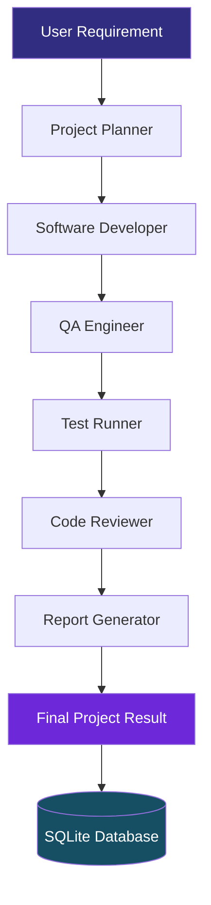

 
<div align="center">


<br/>


<br/>

**An AI-Powered Multi-Agent Software Development Workspace**

<br/>


</div>

---

## ✨ Overview

**DevTeam AI Orchestrator** is an intelligent software development system that coordinates multiple specialized AI agents to transform software requirements into structured development workflows.

Instead of relying on a single AI assistant, DevTeam AI distributes development responsibilities across dedicated agents.

From requirement analysis to final reporting, each agent contributes to a coordinated software engineering process powered by **LangGraph**.

## 🚀 Core Capabilities

- 🤖 Multi-Agent Software Development
- 📋 Automated Requirement Analysis & Planning
- 💻 AI-Powered Code Generation
- 🔍 Automated Quality Assurance
- 🧪 Pytest Execution & Test Reporting
- 🛡️ Intelligent Code Review
- 📊 Structured Development Reports
- 🗂️ SQLite-Based Project History
- ⚡ FastAPI REST API
- 🎨 React-Based Development Workspace
- 🧠 Google Gemini Integration

## 🧠 AI Agent Team

| Agent | Responsibility |
|---|---|
| Project Planner | Analyzes requirements and creates development plans |
| Software Developer | Generates software implementation |
| QA Engineer | Examines implementation and identifies issues |
| Test Runner | Executes available automated tests |
| Code Reviewer | Evaluates code quality and suggests improvements |
| Report Generator | Creates structured development reports |

## ⚙️ System Architecture



## 🛠️ Technology Stack

| Technology | Purpose |
|---|---|
| Python | Backend Development |
| FastAPI | REST API |
| LangGraph | Agent Workflow Orchestration |
| Google Gemini | AI Model Integration |
| React | Frontend Interface |
| Vite | Frontend Development |
| Tailwind CSS | UI Styling |
| SQLite | Database & Persistence |
| Pytest | Automated Testing |

## 📁 Project Structure

```text
DevTeam-AI-Orchestrator/
│
├── backend/
│   ├── agents/
│   │   ├── planner.py
│   │   ├── developer.py
│   │   ├── qa_engineer.py
│   │   └── reviewer.py
│   │
│   ├── services/
│   │   ├── report_generator.py
│   │   └── test_runner.py
│   │
│   ├── workflow/
│   │   ├── graph.py
│   │   └── state.py
│   │
│   ├── config.py
│   ├── database.py
│   ├── llm.py
│   ├── main.py
│   └── schemas.py
│
├── frontend/
│   ├── src/
│   ├── index.html
│   └── package.json
│
├── .gitignore
├── README.md
└── requirements.txt
```

## 💻 Installation & Setup

### 1. Clone Repository

```bash
git clone https://github.com/haniaeman2026-pixel/DevTeam-AI-Orchestrator.git

cd DevTeam-AI-Orchestrator
```

### 2. Create Virtual Environment

```bash
python -m venv .venv
```

Activate on Windows:

```powershell
.\.venv\Scripts\Activate.ps1
```

### 3. Install Dependencies

```bash
pip install -r requirements.txt
```

### 4. Configure Environment Variables

Create a `.env` file in the root directory:

```env
GOOGLE_API_KEY=your_google_api_key
GEMINI_MODEL=your_supported_gemini_model
```

**Important:** Replace the placeholders with your actual API credentials and a model supported by your Gemini API setup. Never upload `.env` to GitHub.

### 5. Run Backend

```bash
python -m uvicorn backend.main:app --reload --host 127.0.0.1 --port 8000
```

Backend:

```text
http://127.0.0.1:8000
```

API Documentation:

```text
http://127.0.0.1:8000/docs
```

### 6. Run Frontend

Open another terminal:

```bash
cd frontend
npm install
npm run dev
```

Frontend:

```text
http://localhost:5173
```

## 🔌 API Endpoints

| Method | Endpoint | Description |
|---|---|---|
| GET | `/api/health` | Backend health check |
| GET | `/api/projects` | Retrieve project history |
| GET | `/api/projects/{project_id}` | Retrieve project details |
| POST | `/api/workflow/run` | Execute AI development workflow |

### Example Workflow Request

```json
{
  "requirement": "Build a Task Management REST API using FastAPI and SQLite with CRUD operations and automated tests."
}
```

## 🔄 Development Workflow

```text
USER REQUIREMENT
       |
       v
REQUIREMENT ANALYSIS
       |
       v
DEVELOPMENT PLANNING
       |
       v
AI CODE GENERATION
       |
       v
QUALITY ASSURANCE
       |
       v
AUTOMATED TESTING
       |
       v
CODE REVIEW
       |
       v
FINAL REPORT
```

## 🔮 Future Enhancements

- Real-Time Agent Execution Monitoring
- Human-in-the-Loop Approval
- Advanced Code Validation
- Multi-Language Development
- Project Export & Download
- Enhanced Workflow Analytics

---

<div align="center">


<br/>

**Hania Eman**

AI & Data Science | Python | AI Agents | Machine Learning

<br/>


</div>
