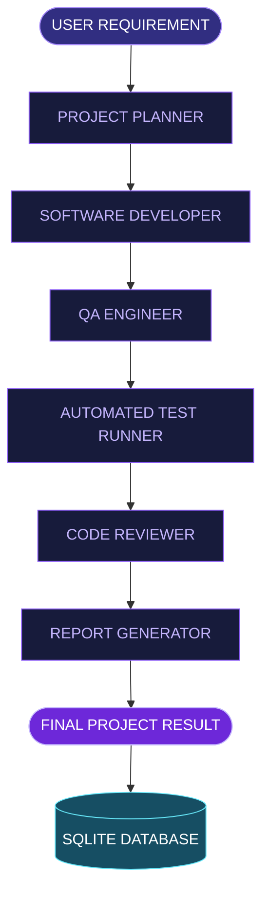

 
<div align="center">


<br/>

<sub>AN INTELLIGENT MULTI-AGENT SOFTWARE DEVELOPMENT WORKSPACE</sub>

<br/><br/>

[](https://python.org)
[](https://fastapi.tiangolo.com)
[](https://www.langchain.com/langgraph)
[](https://ai.google.dev)
[](https://react.dev)

<br/>

**Turning Software Requirements Into Intelligent Development Workflows.**

</div>

---

## ◈ THE VISION

DevTeam AI Orchestrator introduces a collaborative approach to software engineering.

Instead of depending on one general-purpose AI assistant, it coordinates a specialized team of AI agents. Each agent handles a dedicated development responsibility, working together through an orchestrated LangGraph workflow.

From the first requirement to the final development report, the system brings planning, implementation, testing, and code review into one unified workspace.

## ◈ MEET YOUR AI DEVELOPMENT TEAM

<table>
<tr>
<td width="50%">

### ◉ 01 — PROJECT PLANNER

Analyzes user requirements and transforms them into structured development plans.

</td>
<td width="50%">

### ◉ 02 — SOFTWARE DEVELOPER

Generates project implementation based on the approved development plan.

</td>
</tr>
<tr>
<td width="50%">

### ◉ 03 — QA ENGINEER

Evaluates implementation quality and identifies potential issues.

</td>
<td width="50%">

### ◉ 04 — TEST RUNNER

Executes available automated tests using Pytest.

</td>
</tr>
<tr>
<td width="50%">

### ◉ 05 — CODE REVIEWER

Reviews code quality, identifies weaknesses, and suggests improvements.

</td>
<td width="50%">

### ◉ 06 — REPORT GENERATOR

Produces a structured summary of the development workflow and results.

</td>
</tr>
</table>

## ◈ INTELLIGENT WORKFLOW

<div align="center">



**ONE REQUIREMENT → SIX SPECIALIZED AGENTS → ONE COORDINATED RESULT**

</div>

## ◈ CORE CAPABILITIES

| Capability | Description |
|---|---|
| Multi-Agent AI | Specialized agents for development tasks |
| Requirement Analysis | Automated project understanding |
| Code Generation | AI-powered implementation |
| Quality Assurance | Automated implementation review |
| Test Automation | Pytest execution |
| Code Intelligence | AI-assisted code review |
| Project History | SQLite persistence |
| API Integration | FastAPI backend |
| AI Integration | Google Gemini |
| Web Workspace | React-based frontend |

## ◈ TECHNOLOGY ECOSYSTEM

<div align="center">

| BACKEND | AI & ORCHESTRATION | FRONTEND | STORAGE & TESTING |
|:---:|:---:|:---:|:---:|
| Python | Gemini | React | SQLite |
| FastAPI | LangGraph | Vite | Pytest |
| REST API | AI Agents | Tailwind CSS | Database |

</div>

## ◈ PROJECT ARCHITECTURE

```text
DevTeam-AI-Orchestrator/
│
├── backend/
│   ├── agents/
│   │   ├── planner.py
│   │   ├── developer.py
│   │   ├── qa_engineer.py
│   │   └── reviewer.py
│   │
│   ├── services/
│   │   ├── report_generator.py
│   │   └── test_runner.py
│   │
│   ├── workflow/
│   │   ├── graph.py
│   │   └── state.py
│   │
│   ├── config.py
│   ├── database.py
│   ├── llm.py
│   ├── main.py
│   └── schemas.py
│
├── frontend/
│   ├── src/
│   ├── index.html
│   └── package.json
│
├── .gitignore
├── README.md
└── requirements.txt
```

## ◈ GETTING STARTED

**01. Clone the Repository**

```bash
git clone https://github.com/haniaeman2026-pixel/DevTeam-AI-Orchestrator.git
cd DevTeam-AI-Orchestrator
```

**02. Create Virtual Environment**

```bash
python -m venv .venv
.\.venv\Scripts\Activate.ps1
```

**03. Install Dependencies**

```bash
pip install -r requirements.txt
```

**04. Configure API Credentials**

Create `.env` in the root directory:

```env
GOOGLE_API_KEY=your_google_api_key
GEMINI_MODEL=your_supported_gemini_model
```

Never commit your API credentials to GitHub.

**05. Launch Backend**

```bash
python -m uvicorn backend.main:app --reload --host 127.0.0.1 --port 8000
```

**06. Launch Frontend**

```bash
cd frontend
npm install
npm run dev
```

<div align="center">

| SERVICE | LOCAL ADDRESS |
|:---|:---|
| Backend | `http://127.0.0.1:8000` |
| API Documentation | `http://127.0.0.1:8000/docs` |
| Frontend | `http://localhost:5173` |

</div>

## ◈ API REFERENCE

| METHOD | ENDPOINT | FUNCTION |
|:---:|---|---|
| GET | `/api/health` | Backend status |
| GET | `/api/projects` | Project history |
| GET | `/api/projects/{project_id}` | Project details |
| POST | `/api/workflow/run` | Execute AI workflow |

**Example Request**

```json
{
  "requirement": "Build a Task Management REST API using FastAPI and SQLite with CRUD operations and automated tests."
}
```

## ◈ WHAT'S NEXT?

- Real-Time Agent Monitoring
- Human Approval Checkpoints
- Advanced Code Validation
- Multi-Language Development
- Project Export Capabilities
- Enhanced Workflow Analytics

---

<div align="center">


<br/>

**HANIA EMAN**

<sub>AI & DATA SCIENCE · PYTHON · AI AGENTS · MACHINE LEARNING</sub>

<br/><br/>


</div>
